<div align="center">

<a href="https://quantumfork.wtf"></a>

<br/><br/>

<a href="https://quantumfork.wtf"></a>
<a href="https://x.com/quantumforkk"></a>


</div>

<br/>

<h3 align="center">Every blockchain is a set of decisions.</h3>

<p align="center">
Block time. Gas limits. Who orders transactions. Which signatures count. Who can upgrade what.<br/>
They are frozen the day a chain launches, and the only way to try different ones has been to build a new chain.
</p>

<p align="center">
<b>Quantum Fork makes them editable.</b><br/>
It captures a chain's decisions in a single document, its <b>Chain DNA</b>, and hands you a laboratory to<br/>
<b>fork live Base state</b>, <b>replay history</b>, <b>mutate the rules</b>, <b>race realities against each other</b>,<br/>
and <b>harden signatures for a post-quantum world</b>. Every change tells you exactly where it lands:<br/>
a contract, a local devnet, a dedicated rollup, or the frontier of research.
</p>


## The loop


One document travels through eight instruments. Design it, fork a real chain with it, rewind a real
transaction inside it, evolve it, race it against a rival configuration, spin it up as a living network,
stress its cryptography, and publish it at a permanent address. Then do it again.


## The laboratory

<p align="center">
<a href="#01--genesis-studio"></a>
<a href="#02--reality-fork"></a>
<a href="#03--time-machine"></a>
<a href="#04--fork-wars"></a>
<a href="#05--ghost-chains"></a>
<a href="#06--mutation-engine"></a>
<a href="#07--quantum-shield"></a>
<a href="#08--explorer"></a>
</p>


## 01 · Genesis Studio

> **Design the chain.** `/create`

One configuration, three targets: **contracts on Base**, a **local Anvil devnet** forked from Base, or a
**dedicated OP Stack rollup**. Every option in the studio is scored against every target as
`BUILT IN`, `YOUR CONTRACTS`, `NEEDS INFRASTRUCTURE` or `RESEARCH`, so you always see what kind of
system you are actually designing. Switch targets and the whole genome re-scores live.

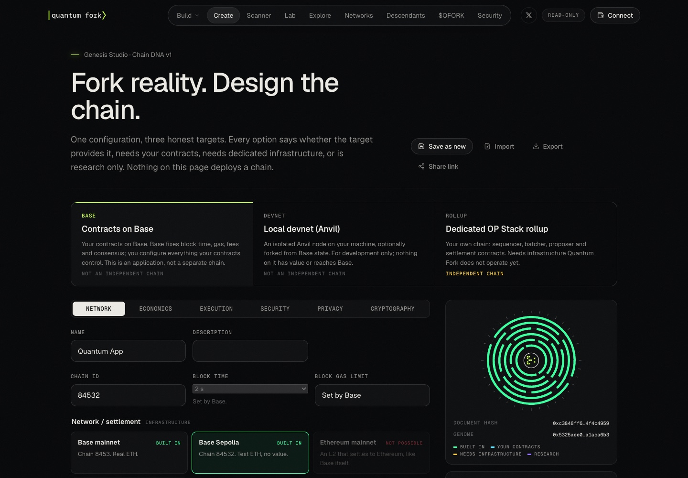

A Chain DNA document is plain, strict JSON. This one validates with zero warnings:

```json
{
  "spec": "qfork/chain-dna/v1",
  "name": "Quantum Devnet",
  "description": "Base Sepolia forked at a pinned block, one-second blocks, passkey accounts.",
  "target": "local-devnet",
  "network":      { "chainId": 375802, "settlement": null, "fork": { "source": "base-sepolia", "block": 49851225 },
                    "access": "private", "blockTimeMs": 1000, "gasLimit": 30000000 },
  "economics":    { "nativeCurrency": "eth", "baseFeeGwei": 0, "feePolicy": "user-pays", "treasury": "none",
                    "token": "none", "distribution": [] },
  "execution":    { "evm": "prague", "precompiles": ["p256"], "accountAbstraction": ["erc4337"], "upgrades": "uups" },
  "security":     { "admin": "multisig", "governance": "none", "sequencing": "single", "keys": "smart-account" },
  "privacy":      { "execution": "public", "zkVerifier": "none", "disclosure": "none" },
  "cryptography": { "auth": "passkey", "rotation": "smart-account" }
}
```

…and compiles straight into a running node:

```bash
anvil --chain-id 375802 --network optimism --hardfork isthmus --block-time 1 --gas-limit 30000000 \
      --base-fee 0 --fork-url https://sepolia.base.org --fork-block-number 49851225
# document hash 0xeaacd831a981e29f859253e42c4a370676c0fe4f6553522cd177c587d6df939c
```

## 02 · Reality Fork

> **Run it twice. Change one thing.** `/lab/reality-fork`

Two Anvil forks of the **same Base block**, each verified against the real block hash. Rewrite contract
code, storage slots or balances on one of them, fire the same transactions at both, and read the
difference straight from the nodes: receipts, gas, events, full `callTracer` call trees and
`prestateTracer` state diffs. Senders are impersonated, so any address on Base can be your test account.

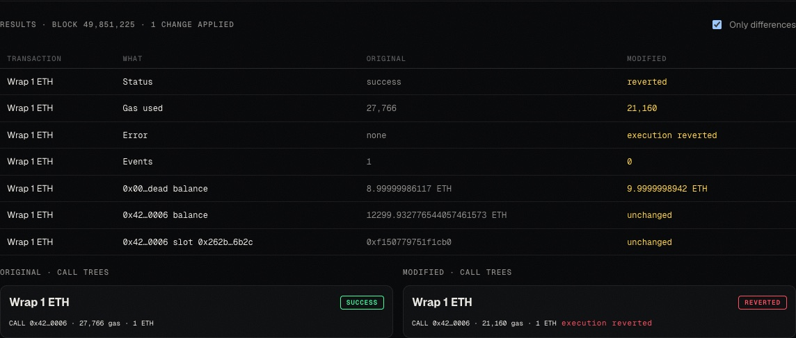

Above: one bytecode change on WETH at block 49,851,225 turns a 27,766-gas success into a 21,160-gas revert,
and the call trees show exactly where.

## 03 · Time Machine

> **Rewind any transaction.** `/lab/time-machine?source=base-sepolia&tx=0x…`

Paste any Base transaction hash. Quantum Fork loads it from chain, forks the **parent block**, then
replays **every transaction ahead of it in that block**, in order, including OP Stack deposit
transactions (`0x7e`), rebuilt byte-for-byte so their hashes match. The target is mined with its
historical timestamp and base fee, and the result is checked against the real receipt.

```
Base Sepolia · block 49,873,286 · tx index 2
  replay   ✓ status success   ✓ gas 113,939   ✓ 2 events   ✓ same block
  edit     calldata changed → reverted · 23,082 gas
```

Then rewrite history: change the calldata, value or gas and run it again after the exact same prefix,
with the historical and edited executions side by side.

## 04 · Fork Wars

> **Race two realities.** `/lab/fork-wars`

Two fresh Anvil nodes, two chain configurations, one workload compiled from real Solidity
(`erc20`, `erc721`, `deploy`, `storage`, `compute`, `mixed`). Every transaction's gas and latency is
recorded, and the Anvil processes' memory and CPU are sampled every 200 ms. The whole run downloads as
a JSON report.

| 4 × ERC-20 transfer | Automine | One-second blocks |
| --- | ---: | ---: |
| Throughput | **66.67 tx/s** | 1.02 tx/s |
| Mean latency | **15 ms** | 977 ms |
| Total gas | 305,746 | 305,746 |
| Peak RSS | **16.0 MB** | 21.8 MB |

<sub>Measured on Apple M4 Max · 14 cores · Anvil 1.7.1 · Node 20.18.</sub>

## 05 · Ghost Chains

> **Spawn ephemeral chains.** `/lab/ghost-chains`

Throwaway EVM networks with a lifespan: **15 minutes, 1 hour, 6 hours or 24 hours**. Each one gets its
own chain ID, its own loopback RPC and a live readout of block height, transaction count, memory and
logs. When time runs out it snapshots its state (`anvil_dumpState`) and disappears.

```
CREATING → RUNNING → EXPIRING → TERMINATED
```

## 06 · Mutation Engine

> **Evolve the genome.** `/lab/mutation`

Chain DNA under version control. Start a lineage, extend it, branch it, roll it back. Every revision
is diffed against its parent and every change is classified by where it would actually land:

| Effect | Meaning |
| --- | --- |
| `contract` | Ships as smart contracts on the current target |
| `built-in` | Already provided by the target |
| `local-anvil` | A setting your local Anvil node can apply |
| `dedicated-chain` | Needs its own chain and client |
| `research` | Designable today, deployable tomorrow |
| `impossible` | Not something this target can ever do, like changing Base consensus from a contract |

## 07 · Quantum Shield

> **Post-quantum, measured.** `/lab/quantum-shield`

NIST's post-quantum signatures, **ML-DSA (FIPS 204)** and **SLH-DSA (FIPS 205)**, running in your
browser next to ECDSA secp256k1 and P-256. Key generation, signing and verification are benchmarked on
your own device in a Web Worker, alongside key and signature sizes and the calldata gas it costs to
carry each signature on Base. There's also a playground: sign, verify, tamper a byte, and watch
verification fail.

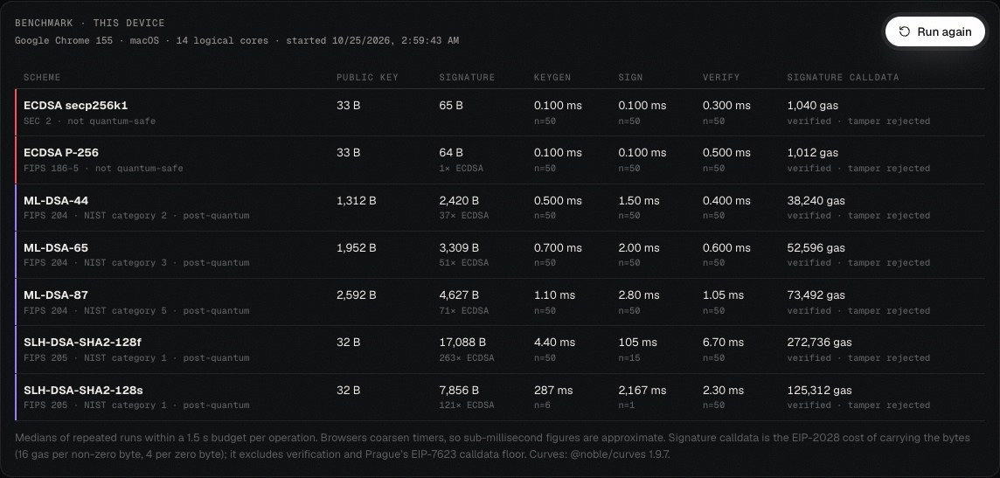

## 08 · Explorer

> **Publish the DNA.** `/explore`

Publish a configuration and the server normalises it, validates it, hashes it and stores it
**write-once** at `/explore/<hash>`, with its genome, readiness and architecture rendered. Anyone with
the link sees the exact same chain you designed. On-chain anchoring goes through
[`QForkRegistry`](./contracts/src/QForkRegistry.sol), a permissionless record of configuration hashes
on Base with no owner, no fees and no upgrade path.

## 09 · Accounts and the post-quantum co-signer

> **Two keys to move funds, one of them post-quantum.** `/account`

[`QForkAccount`](./contracts/src/QForkAccount.sol) is an m-of-n account on Base: owners approve
proposals, agents spend inside per-asset limits, any owner can freeze an agent, and the account
commits to a hash of its owners' ML-DSA and SLH-DSA public keys.

A **co-signer** is one more owner. It approves a proposal only after checking post-quantum signatures
against that commitment:

| Proposal | Needs |
| --- | --- |
| Payments, calls, agent limits | One ML-DSA-65 signature from the daily key |
| Owners, threshold, key set | The recovery threshold of SLH-DSA recovery or guardian signatures |

With 2 of 3 owners (your wallet, the co-signer, a backup wallet), a stolen wallet key cannot move
funds, and a lost wallet is replaced with the recovery key. Keys are generated and used in the browser.

```bash
npm run cosigner                           # Base, on 127.0.0.1:7454
npm run cosigner -- --network base-sepolia # testnet
```

It generates its own key in `~/.qfork-cosigner/key.json` (mode 0600) on first run and only answers
the origins you allow. A hosted co-signer (`/api/cosign`) runs the same checks where it is enabled.
Either way the co-signer is **server-trusted**: Base only sees its ordinary ECDSA approval, so the
post-quantum check is as strong as the machine running it. Base itself stays classical.

## 10 · Descendant networks

> **A descendant registered on Base runs as its own chain, on machines its operators run.** `/network/<id>/nodes`

Each network is [Hyperledger Besu](https://github.com/besu-eth/besu) with **QBFT** consensus: a fixed
set of validators take turns proposing blocks, and every block needs ⌈2n/3⌉ of their signatures, so 4
validators keep finalizing with one down. Quantum Fork never runs or relays nodes. It keeps a
directory of what operators sign:

| Step | Who | What is signed |
| --- | --- | --- |
| List a node | Operator | The listing, by the operator's wallet **and** the node's own key |
| Seal the genesis | The wallet that registered the descendant | The genesis hash and the first validators, write-once |
| Add or remove a validator | The current validators | A QBFT vote; it passes with more than half |

```bash
npm run node -- dev <descendant>                    # one node, no consensus (anvil), for building against
npm run node -- init <descendant> --operator 0x… --host <public IP or domain>   # prints a link to sign
npm run node -- start <descendant> --host <public IP or domain> [--share]
npm run node -- vote <descendant> add <node address>
```

`start` downloads Besu (checked against its published SHA-256; needs Java 25), re-derives the genesis
from the sealed spec and checks the owner's signature before running it, and connects to the listed
peers. The node's own RPC stays on `127.0.0.1`; `--share` puts a gateway in front of it that answers
standard reads and signed transactions and refuses account, admin, debug, txpool and vote methods.

The running chain is a standard EVM chain: validator, peer and transaction keys are classical
secp256k1, and the post-quantum modules in the descendant's genome are not part of it.
`tests/nodes.test.ts` runs four Besu validators, finalizes a transfer through the gateway, stops one
validator and votes a fifth in.


## Architecture

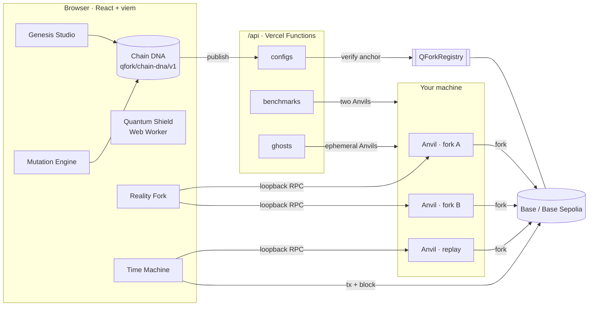

Forks run against **your own** Anvil on loopback, so you control the RPC, the state and the keys.

## Quick start

```bash
git clone https://github.com/quantumforkwtf/quantum-fork.git
cd quantum-fork
npm install
npm run dev                 # http://localhost:5173 (site + /api)
```

The lab instruments use [Foundry](https://book.getfoundry.sh/getting-started/installation)'s Anvil:

```bash
curl -L https://foundry.paradigm.xyz | bash && foundryup

# Reality Fork: two forks of the same block
anvil --fork-url https://sepolia.base.org --fork-block-number <block> --port 8545
anvil --fork-url https://sepolia.base.org --fork-block-number <block> --port 8546
```

Time Machine prints its own Anvil command for the transaction you load. Fork Wars and Ghost Chains start
and stop their Anvil nodes for you when you run `npm run dev`.

```bash
npm run typecheck && npm run lint && npm test && npm run build
cd contracts && forge test
```

## Stack

| Layer | |
| --- | --- |
| App | React 18, TypeScript, Vite 6, Three.js |
| Chain | viem, Anvil, Foundry, Base and Base Sepolia, OP Stack deposit encoding |
| Cryptography | `@noble/post-quantum` (ML-DSA, SLH-DSA), `@noble/curves` (secp256k1, P-256) |
| Server | Vercel Functions, zod, Upstash Redis |
| Contracts | Solidity 0.8, Foundry |

## Repository

```
src/protocol/    the domain: Chain DNA, mutation lineages, replay, fork comparison, benchmarks, ghost lifecycle
src/pages/       one file per route
src/lib/evm/     Base history loader, fork RPC, transaction inspection
src/three/       WebGL scenes
api/             Vercel functions (configs, benchmarks, ghosts, nodes, co-signer, og images, …)
contracts/       QForkRegistry, QForkAccount + benchmark workloads (Foundry)
nodekit/         the descendant node kit: Besu QBFT launcher and RPC gateway
cosigner/        the self-hosted post-quantum co-signer
tests/           280 tests: protocol, replay against Base Sepolia, benchmarks, lineages, crypto
docs/            architecture, roadmap, feature status
```

## Routes

| Path | |
| --- | --- |
| `/create` | Genesis Studio. `?config=<hash>` opens a published design |
| `/lab/reality-fork` | Reality Fork. `?source=base\|base-sepolia&block=N` |
| `/lab/time-machine` | Time Machine. `?source=base\|base-sepolia&tx=0x…` |
| `/lab/fork-wars` | Fork Wars |
| `/lab/ghost-chains` | Ghost Chains |
| `/lab/mutation` | Mutation Engine |
| `/lab/quantum-shield` | Quantum Shield |
| `/explore`, `/explore/:hash` | Published configurations |
| `/scanner` | Quantum exposure map of an existing chain |
| `/blueprints`, `/build` | What do you want to build? Intent-driven blueprints |
| `/species`, `/network` | Descendant explorer and registered networks |
| `/network/:id/nodes` | A descendant's nodes: run commands, signed directory, sealed genesis, live view |

Configuration lives in [`.env.example`](./.env.example). Deep dives:
[architecture](./docs/QUANTUM_FORK_ARCHITECTURE.md) ·
[roadmap](./docs/IMPLEMENTATION_ROADMAP.md) ·
[feature status](./docs/FEATURE_STATUS.md) ·
[threat model](./protocol/THREAT_MODEL.md).

<br/>

<div align="center">


<br/>

**FORK REALITY. BUILD THE NEXT BLOCKCHAIN.**

<a href="https://quantumfork.wtf">quantumfork.wtf</a> · <a href="https://x.com/quantumforkk">@quantumforkk</a>

</div>
